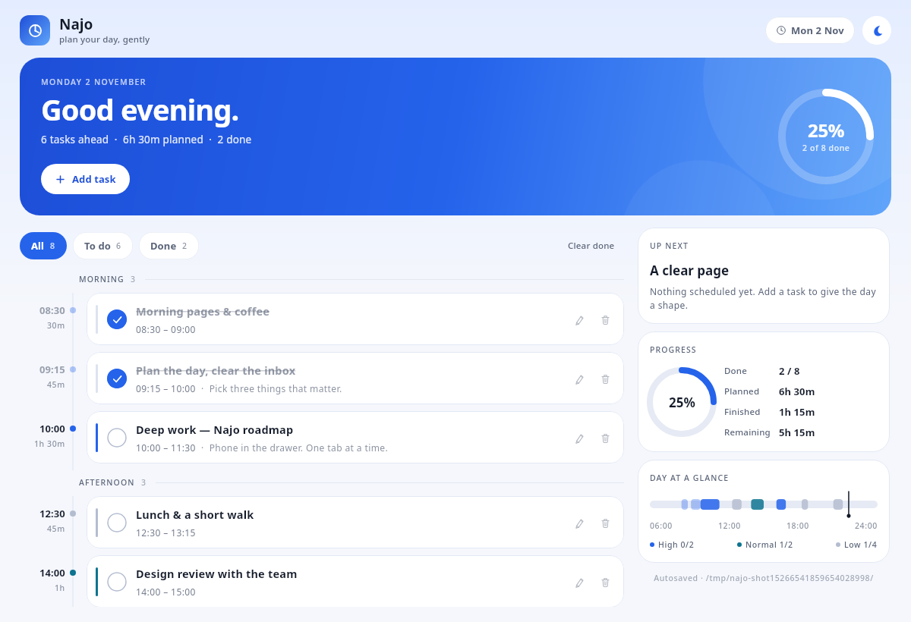
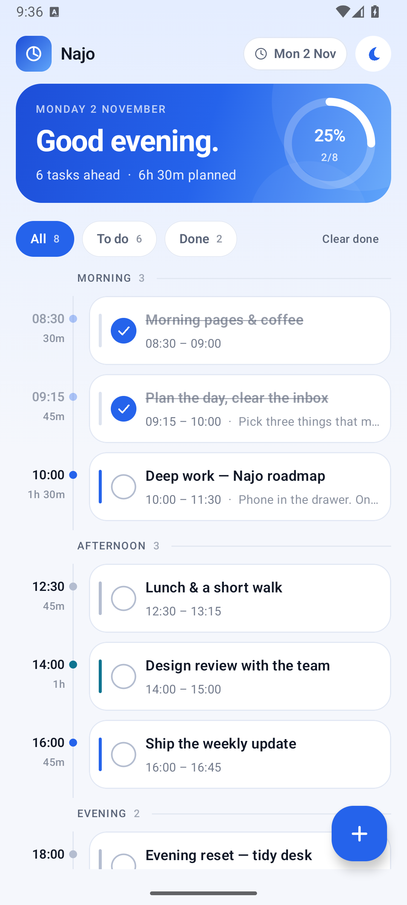

# Najo

A calm, blue day planner — built with Kotlin and Compose, with one shared UI that
runs as an **Android app** and a **desktop app**.

| Desktop | Android |
| --- | --- |
|  |  |

## Features

- A day timeline split into **Morning / Afternoon / Evening**, with start time,
  duration (quick presets or any custom length up to 24 hours), priority and an
  optional note.
- Add, edit, delete and tick off tasks; filter by **All / To do / Done**; clear
  finished tasks in one tap.
- Progress ring, planned-vs-finished time, a **focus now / up next** card, and
  priority counts.
- Overlap warnings for double-booked time, priority-coloured accents, and
  spring-animated checkmarks.
- A **daily streak** that grows when you finish at least one task. The flame
  badge pops when it grows, and the side panel shows your best streak plus the
  last seven days.
- Gentle **missed-block nudges**: when a scheduled block ends without being
  ticked, a warm message offers to reschedule it instead of guilt-tripping you.
- Light and dark themes, remembered across launches.
- Responsive layout: a stats side panel on wide screens; on phones a full-width
  list with a floating add button, a keyboard-aware editor with sticky actions,
  and a compact hero in landscape.
- Saves locally as readable JSON — atomic temp-file + move writes, so a crash
  cannot leave a half-written plan. Your tasks stay put across launches and
  calendar days.
- Starts with a clean day and a friendly empty state — no demo tasks are
  injected into your plan.

Screenshots for [dark mode](docs/desktop-dark.png), the
[desktop editor](docs/desktop-dialog.png), the
[Android editor](docs/android-dialog.png) and
[Android landscape](docs/android-landscape.png) live in `docs/`.

## Project layout

```
src/main/kotlin/com/najo/     Shared model, store, view-model, Compose UI
desktop/src/main/kotlin/      Desktop entry point (Main.kt)
android/                      Standalone Android Gradle build (:app)
docs/                         Screenshots
```

The model, persistence, view-model and every Compose screen live in the
top-level source set. The Android app module compiles that same source directly
(`../../src/main/kotlin` in `android/app/build.gradle.kts`), so there is no
duplicated UI. Only the entry points and storage location differ per platform.

## Desktop

Requirements: JDK 17+ and Gradle 9.x.

```bash
gradle run          # launch the desktop app
gradle test         # unit tests (store + view-model)
gradle packageDeb   # or packageAppImage, to build an installable bundle
```

The plan is stored at `~/.najo/planner.json`.

## Android

Requirements: JDK 17+ and an Android SDK with **platform 36** and
**build-tools 36.1.0**.

```bash
cd android
```

Create `local.properties` (Android Studio does this automatically):

```properties
sdk.dir=/path/to/Android/Sdk
```

Build the debug APK:

```bash
./gradlew :app:assembleDebug
# app/build/outputs/apk/debug/app-debug.apk
```

Install it on a connected phone or emulator:

```bash
adb install -r app/build/outputs/apk/debug/app-debug.apk
# or
./gradlew :app:installDebug
```

- `minSdk` 26 (Android 8.0), `compileSdk`/`targetSdk` 36.
- The Android build uses AGP 9's built-in Kotlin support and its own Gradle 9.8
  wrapper, independent of the desktop build, so the two toolchains cannot
  interfere with each other.
- The plan is stored in the app's private storage as `files/planner.json`
  (debug builds: `adb shell run-as com.najo cat files/planner.json`).

## How it works

- `PlannerViewModel` is a plain Compose state holder — no DI, no Android
  dependency — so the same logic drives both apps.
- `PlannerStore` serialises `PlannerFile` with kotlinx.serialization and writes
  it to a temp file before atomically replacing the previous plan.
- Platform entry points only supply the storage path plus platform chrome
  (desktop window/icon; Android edge-to-edge insets, system bars, back button).
- The blue Material 3 palette, type scale and shapes are defined once in
  `ui/theme/Theme.kt` and shared.

When the app is opened it shows your saved plan, or a clean empty day on first
launch. Nothing is pre-filled; the empty state offers a single "Add a task"
action to get started.

## Tests

```bash
gradle test
```

Covers store round-trips, damaged-file recovery, parent-directory creation,
empty first launch, ordering, filters, stats, overlap detection,
theme/completion persistence, streak growth and reset, overdue-block detection,
and day rollover (saved tasks are kept, not replaced).
